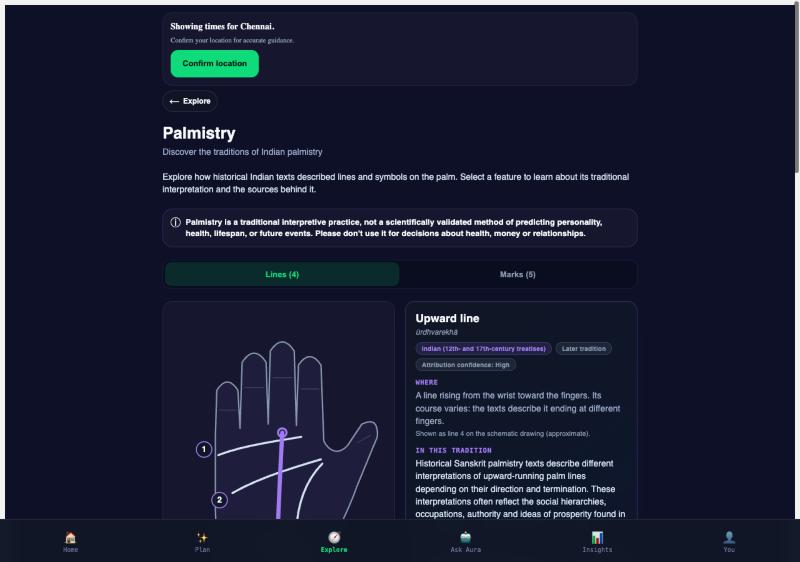
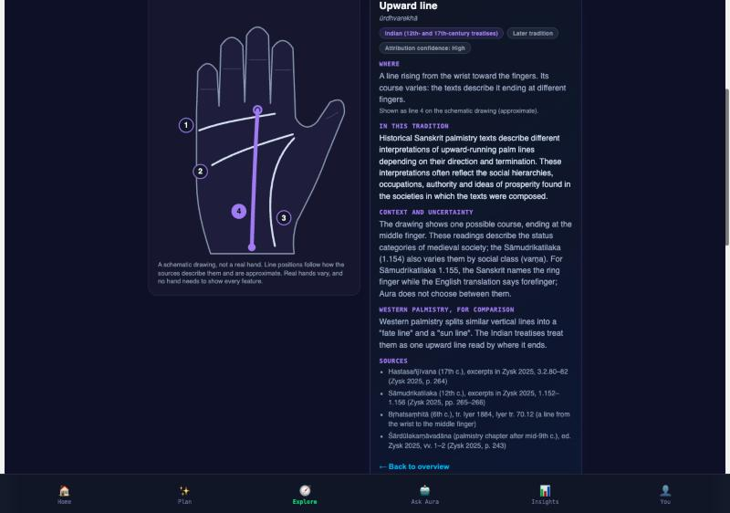

# Aura Palmistry: Final Content for Product Owner Review (G3)

**Status: CONTENT-ONLY MVP — OWNER APPROVED, PUBLICATION AUTHORIZATION PENDING.**
- **Approved by the Product Owner on 2026-11-24** (D2, editorial and cultural review; verbatim in `AURA_PALM_01_GOVERNANCE_RECORDS.md` §6). This is not an independent scholarly review.
- `review-status.json` records that approval on PR #385 only. **Publication is not authorised** (D7), and PR #385 must not be merged until it is.

| Field | Value |
|---|---|
| Content commit | `f723942` (PR #385, branch `feature/aura-palm-01-g3c-a1-rewrite`) |
| sha256 `packages/palmistry/src/content.ts` | `e032fdd3c625f4d6c958edfe0cc59d165bce35da3f5664e706aecb2a1825f538` |
| sha256 `packages/palmistry/src/sources.ts` | `ceb86911cc62bae785ba631de090e0f329d9136f9fe52bef17aec660ce66e5d3` |
| sha256 `apps/web/components/PalmistryView.tsx` | `e2a5158a91b0bcdf4fa206613319bf8c34c6b9753adc42957c7d3cbc4792de70` |
| sha256 `apps/web/components/PalmHandDiagram.tsx` | `3fab074c2693830f43b0d3b91953344a2d46149f64131de38b5daa34288b2453` |
| G3 v1.1 PDF (preserved, unchanged) | `AURA_PALM_01_G3_HUMAN_REVIEW_PACKAGE_v1.1.pdf`, sha256 `d5fb7a1e30c6ad52c1ac7ab9ce06a49d822ee105872099ff74497f48c1719a88`, re-verified 2026-11-24 |
| sha256 `content.ts` after the approval-record commit | `d519bac85b51292e75032344e94ab3ff3f61c7bb3fcc4c4e2e36df4341c99557`. The **only** change from `f723942` is the `approvedBy` type line (line 109), widened to the approved record's fields; no user-facing text changed. `sources.ts`, `PalmistryView.tsx` and `PalmHandDiagram.tsx` are byte-identical to the hashes above |
| How the text was produced | Generated from the committed content modules, then compared with the text rendered by an isolated production build (§J). The rendered text matched |

**Changes since G3 v1.1** (everything else is unchanged; the entry order is unchanged):

| Where | Change |
|---|---|
| Upward line, "In this tradition" | A1 general paragraph (`ec81a27`, owner-supplied), retained |
| General disclosure | W4: second sentence added |
| Prosperity line, context | W2 |
| Upward line, context | W3 ("also … (varṇa)"); ST 1.155 restated neutrally |
| Barleycorn, "In this tradition" | W1 |
| Father line, context | "awaits expert review" → "the cited passage does not say whether …" |
| Preview notice | "awaiting review by a qualified scholar" → "not yet approved for public release" (shown only while unapproved) |

## A. Introduction and disclosures

| Element | Exact text |
|---|---|
| Explore card | Kicker "Palmistry"; title "Learn the lines of the hand"; description "Explore traditional Indian interpretations of palm lines and symbols."; footer "Traditional knowledge · no photo needed" |
| Page title / subtitle | Palmistry / Discover the traditions of Indian palmistry |
| Lead | Explore how historical Indian texts described lines and symbols on the palm. Select a feature to learn about its traditional interpretation and the sources behind it. |
| **General disclosure** (always visible, above the diagram) | **Palmistry is a traditional interpretive practice, not a scientifically validated method of predicting personality, health, lifespan, or future events. Please don't use it for decisions about health, money or relationships.** |
| Preview notice (shown **only** while not approved; disappears on approval) | Preview content: not yet approved for public release. |
| Diagram caption | A schematic drawing, not a real hand. Line positions follow how the sources describe them and are approximate. Real hands vary, and no hand needs to show every feature. |
| Marks note | Marks are shown as symbols, not placed on a hand: the sources do not fix one position for each, and no palm is expected to carry them. |
| Longevity disclosure (on the Longevity line entry) | Aura does not estimate lifespan or predict death. This entry explains a historical idea only. |

## B. The four lines

### B1. Longevity line: āyurlekhā

Badge: Classical source · Tradition: Indian (classical) · Attribution confidence: High

| Label | Exact text |
|---|---|
| Where | The uppermost of the main lines, closest to the fingers. The texts describe it as starting below the little finger and running toward the base of the forefinger. |
| (drawing note) | Shown as line 1 on the schematic drawing (approximate). |
| In this tradition | In this tradition, the line was associated with length of life, read from how far it reached toward the forefinger. The Bṛhatsaṃhitā and a later Buddhist palmistry chapter (compiled after the mid-9th century) both describe this idea. |
| (disclosure) | **Aura does not estimate lifespan or predict death. This entry explains a historical idea only.** |
| Context and uncertainty | The sources disagree on how the line was measured, which shows this was a scheme of interpretation, not a measurement. The term āyurlekhā appears in verse 6 of the early Buddhist chapter (and is an editor's suggested reading in verse 3); later diagrams label the line āyur-. |
| Western palmistry, for comparison | Western palmistry calls a crease in roughly this position the "heart line" and reads it differently. It is not the Western "life line". |
| Sources | Bṛhatsaṃhitā (6th c.), tr. Iyer 1884, Iyer tr. 68.50; 70.13 Śārdūlakarṇāvadāna (palmistry chapter after mid-9th c.), ed. Zysk 2025, vv. 3, 6 (Zysk 2025, pp. 244–245) Indian hand diagrams (18th c. onward), described in Zysk 2025, figs. 1–3 (Zysk 2025, p. 244) |

### B2. Prosperity line (mother line): dhanamātṛlekhā

Badge: Later tradition · Tradition: Indian (early Buddhist text; later diagrams) · Attribution confidence: Medium

| Label | Exact text |
|---|---|
| Where | A line in the middle of the palm, between the longevity line above and the father or knowledge line below. |
| (drawing note) | Shown as line 2 on the schematic drawing (approximate). |
| In this tradition | An early Buddhist palmistry chapter (after the mid-9th century) links the middle line with wealth and names it after a lunar asterism. Later hand diagrams label it the "prosperity-mother" line. |
| Context and uncertainty | The compound name comes from the later diagrams, whose spellings vary. Which asterism the early text means is uncertain (possibly Dhaniṣṭhā). Here "wealth" is a traditional category, not a forecast of anyone's finances. |
| Western palmistry, for comparison | Western palmistry calls a crease in a similar place the "head line" and gives it a different meaning. |
| Sources | Śārdūlakarṇāvadāna (palmistry chapter after mid-9th c.), ed. Zysk 2025, vv. 6, 24 (Zysk 2025, pp. 245–246, 255) Indian hand diagrams (18th c. onward), described in Zysk 2025, figs. 1–3 (Zysk 2025, p. 246) |

### B3. Father line (knowledge line): pitṛlekhā

Badge: Later tradition · Tradition: Indian (early Buddhist text; later diagrams) · Attribution confidence: Medium

| Label | Exact text |
|---|---|
| Where | A line that rises from the base of the thumb near the wrist. The 12th-century Sāmudrikatilaka describes the first lines of the palm as reaching between the thumb and forefinger. |
| (drawing note) | Shown as line 3 on the schematic drawing (approximate). |
| In this tradition | The early Buddhist palmistry chapter calls this a line of knowledge. Later hand diagrams name it the father's line, and one links it with Sarasvatī, the goddess of learning. |
| Context and uncertainty | The sources say little about how this line was read in detail. It was a traditional label, not a measure of intelligence, ancestry or character. The 12th-century Sāmudrikatilaka groups three lines as concerning family, wealth and longevity; the cited passage does not say whether its "family" line is this father line. |
| Western palmistry, for comparison | Western palmistry calls a crease curving round the thumb the "life line". In the Indian texts, the line linked with life is the longevity line at the top of the palm instead. |
| Sources | Śārdūlakarṇāvadāna (palmistry chapter after mid-9th c.), ed. Zysk 2025, vv. 1–2 (Zysk 2025, p. 243) Indian hand diagrams (18th c. onward), described in Zysk 2025, figs. 1–3 (Zysk 2025, p. 243) Sāmudrikatilaka (12th c.), excerpts in Zysk 2025, 1.143 (Zysk 2025, p. 265) |

### B4. Upward line: ūrdhvarekhā

Badge: Later tradition · Tradition: Indian (12th- and 17th-century treatises) · Attribution confidence: High

| Label | Exact text |
|---|---|
| Where | A line rising from the wrist toward the fingers. Its course varies: the texts describe it ending at different fingers. |
| (drawing note) | Shown as line 4 on the schematic drawing (approximate). |
| In this tradition | Historical Sanskrit palmistry texts describe different interpretations of upward-running palm lines depending on their direction and termination. These interpretations often reflect the social hierarchies, occupations, authority and ideas of prosperity found in the societies in which the texts were composed. |
| Context and uncertainty | The drawing shows one possible course, ending at the middle finger. These readings describe the status categories of medieval society; the Sāmudrikatilaka (1.154) also varies them by social class (varṇa). For Sāmudrikatilaka 1.155, the Sanskrit names the ring finger while the English translation says forefinger; Aura does not choose between them. |
| Western palmistry, for comparison | Western palmistry splits similar vertical lines into a "fate line" and a "sun line". The Indian treatises treat them as one upward line read by where it ends. |
| Sources | Hastasañjīvana (17th c.), excerpts in Zysk 2025, 3.2.80–82 (Zysk 2025, p. 264) Sāmudrikatilaka (12th c.), excerpts in Zysk 2025, 1.152–1.156 (Zysk 2025, pp. 265–266) Bṛhatsaṃhitā (6th c.), tr. Iyer 1884, Iyer tr. 70.12 (a line from the wrist to the middle finger) Śārdūlakarṇāvadāna (palmistry chapter after mid-9th c.), ed. Zysk 2025, vv. 1–2 (Zysk 2025, p. 243) |

## C. The five marks

### C1. Barleycorn: yava

Badge: Classical source · Tradition: Indian (classical) · Attribution confidence: High

| Label | Exact text |
|---|---|
| Where | A small mark shaped like a grain of barley, usually described on or at the base of the thumb. |
| (drawing note) | Shown as a symbol only. Its position is not drawn on the hand. |
| In this tradition | Historically, this mark was interpreted as a sign of prosperity. The Bṛhatsaṃhitā also links a barleycorn at the thumb's root with having sons, reflecting the concerns of texts of that period. An early Buddhist palmistry chapter (after the mid-9th century) uses its position on the thumb in omens about the time of birth. |
| Context and uncertainty | Interpretations vary across sources, and the early Buddhist chapter alone gives several different readings. |
| Sources | Bṛhatsaṃhitā (6th c.), tr. Iyer 1884, Iyer tr. 68.42 (Sanskrit editions: 67.42) Śārdūlakarṇāvadāna (palmistry chapter after mid-9th c.), ed. Zysk 2025, vv. 9–15, 22 (Zysk 2025, pp. 247–254) |

### C2. Fish: matsya

Badge: Classical source · Tradition: Indian (classical) · Attribution confidence: High

| Label | Exact text |
|---|---|
| Where | A mark shaped like a fish. The Bṛhatsaṃhitā places it in the middle of the palm; some later diagrams draw it just above the wrist. |
| (drawing note) | Shown as a symbol only. Its position is not drawn on the hand. |
| In this tradition | The texts associate the fish with abundance. The Bṛhatsaṃhitā links two fish marks with feeding many people, and the early Buddhist chapter links the fish with drink, food and wealth. |
| Context and uncertainty | The sources disagree on the fish's meaning and its position. Zysk notes that the fish appears twice in the early Buddhist chapter, which suggests two source traditions were merged. |
| Sources | Bṛhatsaṃhitā (6th c.), tr. Iyer 1884, Iyer tr. 68.44 Śārdūlakarṇāvadāna (palmistry chapter after mid-9th c.), ed. Zysk 2025, vv. 15, 22 (Zysk 2025, pp. 250–254) |

### C3. Conch shell: śaṅkha

Badge: Classical source · Tradition: Indian (classical) · Attribution confidence: High

| Label | Exact text |
|---|---|
| Where | A mark shaped like a conch shell. The sources do not fix one position on the palm. |
| (drawing note) | Shown as a symbol only. Its position is not drawn on the hand. |
| In this tradition | The conch is one of the "royal" marks. The Bṛhatsaṃhitā lists it among signs of kingship, and the early Buddhist chapter names a king as one whose palms show a conch together with a parasol, a wheel and an elephant's foot. |
| Context and uncertainty | Royal marks reflect ideals of kingship in early Indian society; the conch is also a familiar symbol in Indian art and ritual. Zysk notes the verse stresses the princely or warrior class. |
| Sources | Bṛhatsaṃhitā (6th c.), tr. Iyer 1884, Iyer tr. 68.45; 70.10 Śārdūlakarṇāvadāna (palmistry chapter after mid-9th c.), ed. Zysk 2025, v. 21 (Zysk 2025, p. 253) |

### C4. Parasol: chatra

Badge: Classical source · Tradition: Indian (classical) · Attribution confidence: High

| Label | Exact text |
|---|---|
| Where | A mark shaped like a parasol or umbrella, the traditional canopy held over royalty. The sources do not fix one position on the palm. |
| (drawing note) | Shown as a symbol only. Its position is not drawn on the hand. |
| In this tradition | Like the conch, the parasol belongs to the royal marks. The Bṛhatsaṃhitā lists it among signs of kingship for men and queenship for women, and the early Buddhist chapter pairs it with the conch as a king's mark. |
| Context and uncertainty | In verse 21 the manuscripts read an "elephant parasol"; the 1954 editor emended this to "king's parasol". The term appears there inside that compound. |
| Sources | Bṛhatsaṃhitā (6th c.), tr. Iyer 1884, Iyer tr. 68.45; 70.10 Śārdūlakarṇāvadāna (palmistry chapter after mid-9th c.), ed. Zysk 2025, v. 21 (Zysk 2025, p. 253) |

### C5. Altar: vedī

Badge: Classical source · Tradition: Indian (classical) · Attribution confidence: High

| Label | Exact text |
|---|---|
| Where | A mark shaped like a Vedic sacrificial altar. The Bṛhatsaṃhitā places it at the root of the thumb. |
| (drawing note) | Shown as a symbol only. Its position is not drawn on the hand. |
| In this tradition | Historically, this mark was associated with performing sacrificial rites. Both the Bṛhatsaṃhitā and the early Buddhist chapter describe it this way. |
| Context and uncertainty | The meaning reflects the ritual life of early India. The two sources agree on the association; only the Bṛhatsaṃhitā gives a position. |
| Sources | Bṛhatsaṃhitā (6th c.), tr. Iyer 1884, Iyer tr. 68.48 Śārdūlakarṇāvadāna (palmistry chapter after mid-9th c.), ed. Zysk 2025, v. 22 (Zysk 2025, p. 254) |

## D. Historical and cultural context ("About this tradition")

| Element | Exact text |
|---|---|
| Tradition | Indian texts on reading the hand, which scholars group under Rekhāśāstra ("the study of lines"), belong to a wider tradition of reading marks on the whole body. Early descriptions of the hand appear in the Bṛhatsaṃhitā (6th century) and in a Buddhist text whose palmistry chapter was compiled after the mid-9th century. Fuller treatises followed in the 12th and 17th centuries. |
| Lines and marks | The texts read two kinds of features: lines, which they apply to everyone, and shaped marks such as a fish or a parasol, which mostly signal royal or high status. Interpretations differ between texts, and Aura shows those differences rather than resolving them. |
| Indian and Western palmistry (heading) | Western palmistry, as popularised in 19th-century Europe, uses different names (heart, head, life and fate lines) and planetary "mounts". Its labels do not translate the Indian terms: the same crease can carry a different name and meaning in each system. |
| Which hand? | Indian palmistry texts traditionally examined the right hand of men and the left hand of women. The drawing shows a right hand only to illustrate; Aura does not ask which hand you use or infer anything about you. |
| Limits | These are descriptions of what historical texts said, in the social world they came from. They are not claims about you. |

## E. Illustrations

These are original inline SVG drawings in `PalmHandDiagram.tsx` (G3-C waiver R-3/R-4; licensing question L6 is covered by the owner's licensing acceptance). Screenshots come from the isolated release-candidate build described in §J (desktop, 1280×900).

| | |
|---|---|
|  |  |
| 01: introduction, general disclosure (with W4), Lines/Marks switch. No preview notice, because the fixture is APPROVED | 02: schematic hand with numbered lines; Upward line selected (A1 paragraph, W3, ST 1.155) |
|  |  |
| 03: five mark glyphs and the marks note; Barleycorn selected (W1) | 04: About this tradition, Which hand?, and the Sources list with the CC BY-SA 4.0 notice |

## F. Source attribution (Sources list, as rendered)

- **Early Indian Palmistry. Śārdūlakarṇāvadāna: Pāṇilekhā**. Kenneth G. Zysk. 2025 (scholarly edition). History of Science in South Asia 13 (2025): 240–275. DOI 10.18732/hssa128. [Source link](https://journals.library.ualberta.ca/hssa/index.php/hssa/article/view/128) © Kenneth G. Zysk, licensed under [CC BY-SA 4.0](https://creativecommons.org/licenses/by-sa/4.0/); Aura's text paraphrases this work.
- **Śārdūlakarṇāvadāna, chapter "Pāṇilekhā" (lines on the hands)**. Buddhist Sanskrit text (anonymous compilation). Palmistry chapter entered the text after the mid-9th century CE (Zysk 2025, p. 240). Critical edition and English translation in Zysk 2025. [Source link](https://journals.library.ualberta.ca/hssa/index.php/hssa/article/view/128)
- **Bṛhatsaṃhitā, chapters on the marks of men and of women**. Varāhamihira. 6th century CE (Zysk 2025, p. 240). N. Chidambaram Iyer, English translation (1884), as hosted by wisdomlib.org. [Source link](https://www.wisdomlib.org/hinduism/book/brihat-samhita/d/doc229330.html)
- **Sāmudrikatilaka**. Durlabharāja, completed by his son Jagaddeva. 1160–1175 CE (Zysk 2025, p. 242). Excerpts translated in Zysk 2025, Appendix I. [Source link](https://journals.library.ualberta.ca/hssa/index.php/hssa/article/view/128)
- **Hastasañjīvana**. Meghavijaya Gaṇi, Jain author of the Tapāgaccha (active 1674–1695), per Zysk 2025, p. 241 (some catalogues treat him as the commentator rather than the root-text author). Late 17th century CE (Zysk 2025, p. 241). Excerpts translated in Zysk 2025, Appendix I. [Source link](https://journals.library.ualberta.ca/hssa/index.php/hssa/article/view/128)
- **Manuscript hand diagrams reproduced in Zysk 2025, figs. 1–5**. Anonymous palmistry diagrams (Rajasthan, Banaras and elsewhere). Figs. 3–4: 1732–1748 CE; fig. 1 undated; fig. 2: 1929 print; fig. 5: 2002 print. Zysk 2025, Appendix II (described in commentary; images NOT reproduced by Aura). [Source link](https://journals.library.ualberta.ca/hssa/index.php/hssa/article/view/128)

Footnote under the list: "All descriptions are Aura's own paraphrases. No translations or diagrams are reproduced."

## G. Remaining material textual uncertainties

These are shown to users wherever the text makes the claim. None is resolved by a scholar. Full dispositions: `AURA-PALM-01-G3-SCHOLAR-WAIVER.md` §3.

| # | Uncertainty | How the text handles it |
|---|---|---|
| 1 | **āyurlekhā** is an editor's suggested reading in v. 3 (Q1) | Context note says so |
| 2 | **dhanamātṛlekhā** spelling and the "mother" element vary across diagrams (Q2) | Context note: "spellings vary"; asterism "uncertain (possibly Dhaniṣṭhā)" |
| 3 | Whether the Sāmudrikatilaka's **"family" line is the father line** (Q3) | AI-checked against Zysk p. 265: the passage does not say. The text states that neutrally |
| 4 | **ST 1.155** names the ring finger (Sanskrit) but the forefinger in the English translation (Q5) | AI-checked against Zysk p. 265. Stated; "Aura does not choose between them" |
| 5 | **Social-role framing** of the upward line, and varṇa (Q6) | A1 general paragraph plus W3 |
| 6 | **chatra** occurs only inside an emended compound in v. 21 (Q9) | Context note states the manuscript reading and the emendation |
| 7 | Research limits: Bṛhatsaṃhitā Sanskrit not checked; three sources read only via Zysk 2025; no regional traditions | Not shown in the guide. Accepted only if the owner approves the scholar waiver (risks S-2 to S-4) |

## H. Product Owner editorial and cultural checklist

Tick each item, or give the exact change wanted. **Blank = not reviewed.**

| # | Check | Owner |
|---|---|---|
| H1 | The general disclosure (with W4) and the longevity disclosure are clear to a general adult reader | ✅ (D2) |
| H2 | No sentence predicts or implies health, lifespan, relationships, children or finances for the reader | ✅ (D2) |
| H3 | Status- and caste-linked readings (Upward line, W3 "varṇa"; royal marks) are presented as historical categories, responsibly | ✅ (D2) |
| H4 | Gendered content (Barleycorn "having sons" with W1 framing; Which hand?; Parasol "queenship for women") is presented responsibly | ✅ (D2) |
| H5 | Religious and ritual references (Sarasvatī; Vedic altar, sacrificial rites; conch) are respectful and accurate as far as the owner can judge | ✅ (D2) |
| H6 | No sensational, mocking or misleading wording; the tone is educational throughout | ✅ (D2) |
| H7 | The uncertainties in §G are stated plainly enough, and none should be removed instead of stated | ✅ (D2) |
| H8 | Attribution in §F is complete (Zysk CC BY-SA 4.0 notice and link, paraphrase notice, Iyer citation) | ✅ (D2) |
| H9 | The hand drawing and mark glyphs (§E) are acceptable to publish | ✅ (D2) |
| H10 | I have reviewed the exact content at commit `f723942` with the hashes above | ✅ (D2) |

**Owner confirmation (2026-11-24, D2, verbatim):** "APPROVED without further content changes. I have personally reviewed the final content and illustrations against checklist H1–H10 and approve the exact content at `f723942`, with the hashes recorded in the final-content review document. This is Product Owner editorial and cultural approval, not independent scholarly approval."

The ✅ marks above record that statement; the owner did not answer each item separately.

## I. Residual risk summary

| Area | Risk | Status |
|---|---|---|
| Licensing | R-1 ShareAlike; R-2 selection and arrangement; R-3 AI authorship; R-4 unknown reproduction; R-5 cross-border; R-6 Iyer public-domain status | **Accepted** by the owner, 2026-11-24 (G3-C waiver §3–§4) |
| Scholarship | S-1 unreviewed readings (Q1, Q2, Q5, Q6, Q9); S-2 Bṛhatsaṃhitā Sanskrit unchecked; S-3 single secondary source; S-4 narrow coverage; S-5 AI-only checks; S-6 cultural sensitivity reviewed only by the owner; S-7 no independent reviewer | **Accepted** by the owner, 2026-11-24 (D1) |
| Governance | GF-1/GF-2/GF-3 transcriptions confirmed (D3); HR2 content-only split adopted (D4); Stage 1 accepted, scoped (D5); C6-S1, R2-N5, S1C-F4 accepted as limitations, not remediated (D6) | Decided 2026-11-24 (`AURA_PALM_01_GOVERNANCE_RECORDS.md`) |
| Product | Educational content only. No scanning, camera, upload, personalisation or prediction is shipped (§J) | Verified on the RC build |
| Release | Publication needs a separate authorisation (HR2 item M, public-release gate). Merging PR #385 would make the guide eligible for the next Production build. Vercel production git builds are currently skipped. The owner requires the actual release artifact to be verified before any Production promotion (D6) | **Not authorised** (D7) |

## J. Verification (2026-11-24, local, at `f723942`)

| Check | Result |
|---|---|
| `palm01I1Content` (content, privacy, isolation; new D9: no workflow wording) | 221 passed, 0 failed |
| `palm01I1ExploreJsdom` (guide component) | 78 / 0 |
| `palm01P4VercelGuard` (publication guard) | 30 / 0 |
| `palmG5I1PrivacyGate` | 143 / 0 |
| `palmG5I1R2ProductionExclusion` | 65 / 0 |
| **Production build, real state** (isolated clone, `PENDING_HUMAN_REVIEW`) | `next build` OK. `check-palmistry-bundle`: **none of 8 Palmistry sentinels**, no image-input or MediaPipe sentinels or artifacts (2345 files). Engine bundle check OK. The public-build exclusion is **preserved** |
| **Release-candidate build** (separate isolated clone, no git remote; `review-status.json` set to a fixture `{"status":"APPROVED","approvedBy":{"reviewer":"LOCAL-RC-FIXTURE (not an approval; isolated clone only)",…}}` that was **never committed**) | `next build` OK. Guide content present in the page chunk. Image-input exclusion OK (2345 files; no `@mediapipe` in standalone). Engine bundle check OK |
| RC rendered (`next start` on 127.0.0.1, throwaway loopback Postgres, synthetic `example.test` account) | The guide opens from Explore. Rendered text of all 9 entries, the intro, About and Sources **matches §A–§F**. DOM: 0 file inputs, 0 `video`, 0 `canvas`, 0 `capture` attributes; no photo, upload, camera or scan text; no preview notice (fixture). Network: only `127.0.0.1` requests; no MediaPipe, WASM, model or Google requests |
| Not exposed or bundled through the guide | Camera access, photo upload, MediaPipe scanner, personalised palm reading, prediction |

The RC clone, its build and the throwaway database have been stopped and stay in the session scratchpad only. Nothing was deployed.
